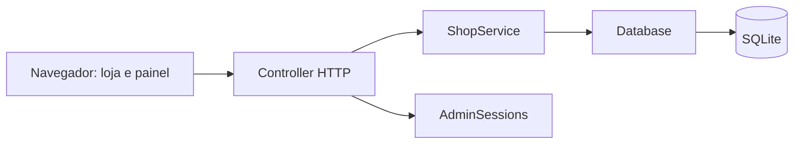
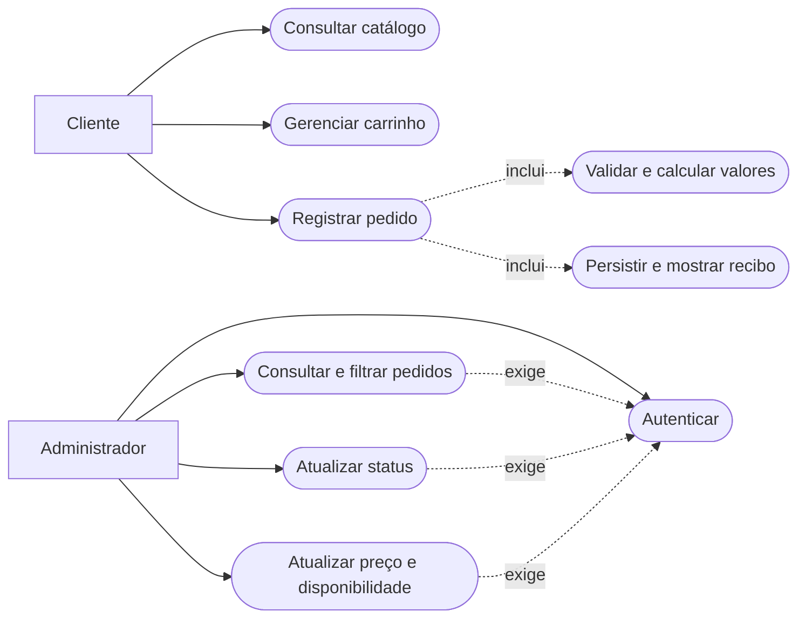
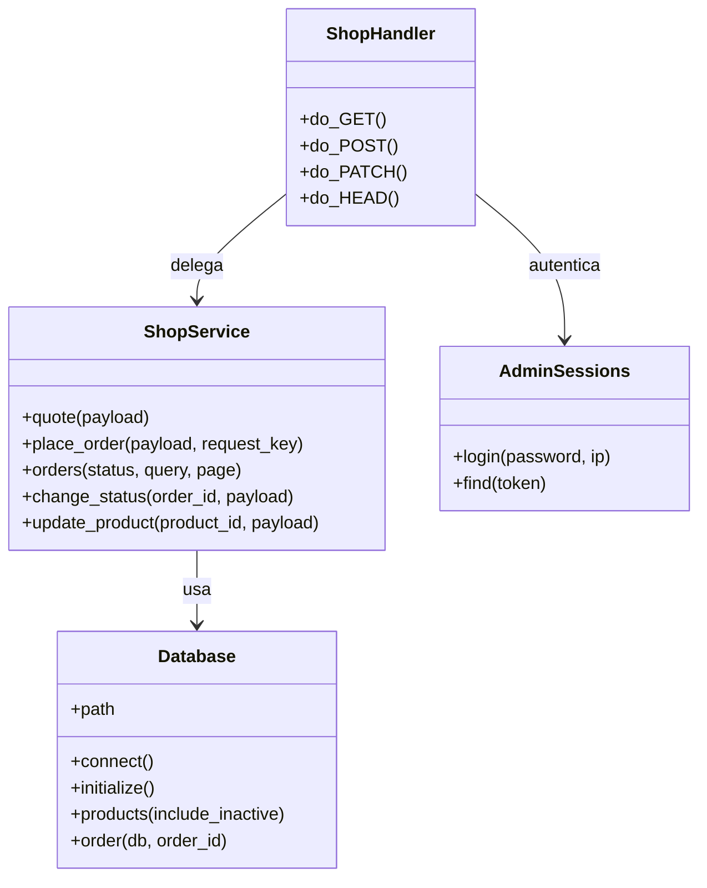
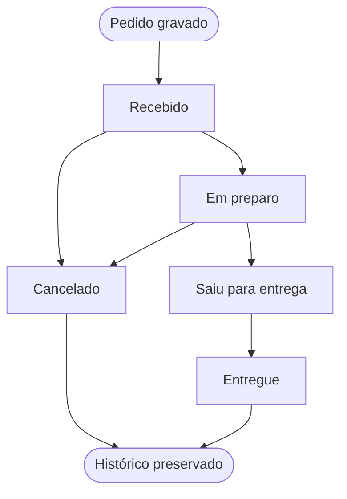
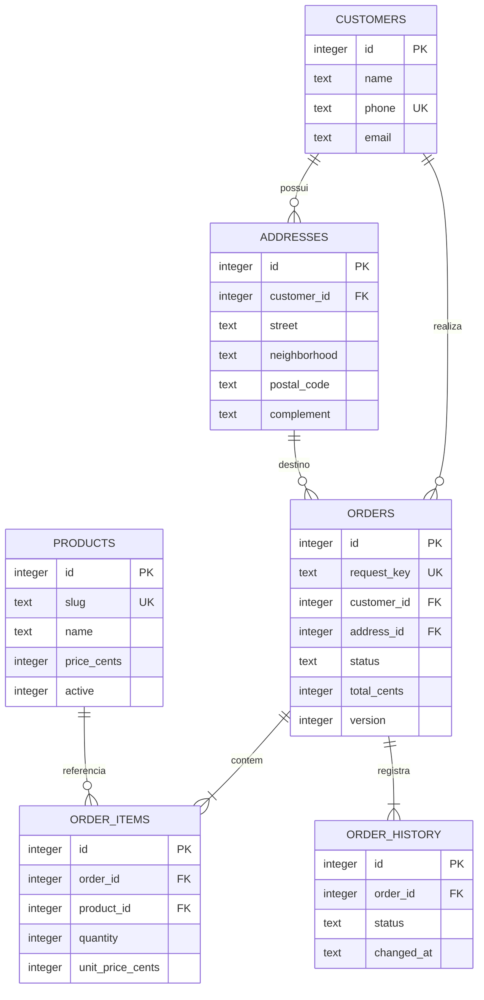

# Modelagem, arquitetura e banco

## Arquitetura inspirada em MVC

HTML/CSS/JavaScript são as vistas. `backend/controllers.py` recebe HTTP, autentica e serializa respostas. `backend/services.py` separa regras de negócio e transações. `backend/models.py` concentra banco e consultas. `app.py` compõe os componentes. A camada de serviço evita concentrar negócio no controller.



## Casos de uso



Registro: pré-condição é carrinho com produto ativo. O cliente preenche dados, seleciona pagamento, obtém orçamento e confirma. O sistema valida e grava tudo em transação. Campo inválido solicita correção; produto indisponível impede registro; falha de conexão preserva entradas; repetição da mesma solicitação retorna o pedido existente.

## Classes implementadas



## Sequência do registro

```mermaid
sequenceDiagram
    actor Cliente
    participant View as Checkout JS
    participant C as Controller
    participant S as ShopService
    participant DB as SQLite
    Cliente->>View: Confirmar encomenda
    View->>C: POST /api/orders e Idempotency-Key
    C->>S: place_order(payload, key)
    S->>DB: BEGIN IMMEDIATE; consultar chave
    alt Chave e corpo existentes
      DB-->>S: Mesmo pedido
      S-->>C: Pedido existente
      C-->>View: HTTP 200
    else Solicitação nova e válida
      S->>DB: Consultar produtos e calcular total
      S->>DB: Gravar cliente, endereço, pedido, itens e histórico
      S->>DB: COMMIT
      S-->>C: Pedido criado
      C-->>View: HTTP 201 e número real
    end
    View-->>Cliente: Recibo; limpar carrinho após sucesso
```

## Atividade do atendimento



## Modelo conceitual e lógico

Cliente possui endereços e realiza pedidos; pedido usa um endereço, contém itens e tem histórico. Produto participa de itens. A associação N:N pedido/produto é resolvida por order_items.



## Normalização e decisão histórica

Valores atômicos e listas separadas em itens/histórico atendem à 1FN. Cada tabela possui chave primária simples e atributos dependentes de sua entidade (2FN). Cadastros de produto, cliente e endereço são separados, evitando dependências transitivas dos dados cadastrais nos itens (3FN).

Nome/preço do item e destinatário do pedido são retratos históricos intencionais: descrevem a transação realizada, enquanto o cadastro pode mudar. Totais são materializados para auditoria e calculados pelo serviço. Não se afirma eliminação absoluta de redundância; esses campos são uma decisão explícita de preservação do pedido.

## Modelo físico e dicionário

O DDL completo executável está em `Database.initialize()` de `backend/models.py`. O arquivo data/sweetbloom.sqlite3 é criado automaticamente. Cada conexão habilita chaves estrangeiras; o serviço valida tipos e comprimentos, complementando NOT NULL, CHECK e UNIQUE.

| Tabela | Campos e tipos | Restrições e finalidade |
|---|---|---|
| products | id INTEGER; slug/name/description TEXT; price_cents/active INTEGER | PK id; slug único; preço 1 a 1.000.000 centavos; active 0/1 |
| customers | id INTEGER; name/phone/email TEXT | PK id; telefone normalizado único; e-mail opcional vazio |
| addresses | id/customer_id INTEGER; street/neighborhood/postal_code/complement TEXT | PK id; FK cliente; rua/bairro obrigatórios; CEP/complemento opcionais |
| orders | id/customer_id/address_id INTEGER; request_key/request_hash TEXT | PK id; FKs cliente/endereço; chave única; SHA-256 do corpo para identificar repetição |
| orders | recipient_name/recipient_phone/recipient_email/payment/notes/status/created_at TEXT | Destinatário da transação; meios/status enumerados; data UTC |
| orders | subtotal_cents/discount_cents/delivery_cents/total_cents/version INTEGER | Centavos inteiros; versão inicial 1 para controle de conflito |
| order_items | id/order_id/product_id/unit_price_cents/quantity INTEGER; product_name TEXT | PK; FKs; par pedido/produto único; quantidade 1 a 99; preço/nome históricos |
| order_history | id/order_id INTEGER; status/changed_at TEXT | PK; FK pedido; evento e data UTC |

Índices: status dos pedidos, itens por pedido e histórico por pedido. A carga inicial insere seis produtos apenas quando o catálogo está vazio; alterações administrativas sobrevivem ao reinício. Cancelamento não exclui fisicamente encomendas.

## API

| Método/rota | Acesso | Resultado |
|---|---|---|
| GET /api/products | Público | Produtos ativos |
| POST /api/quote | Público | Orçamento validado |
| POST /api/orders | Público e chave | Pedido novo 201 ou repetido 200 |
| GET /api/admin/session | Sessão opcional | Autenticação e CSRF |
| POST /api/admin/login | Senha | Sessão |
| POST /api/admin/logout | Sessão + CSRF | Encerrar sessão |
| GET /api/admin/orders | Sessão | Filtros status/q/page e paginação |
| GET /api/admin/products | Sessão | Todos os produtos |
| PATCH /api/admin/orders/{id} | Sessão + CSRF | Atualização de status/versão |
| PATCH /api/admin/products/{id} | Sessão + CSRF | Preço e disponibilidade |

Erros JSON: 400 validação, 401 autenticação, 403 origem/CSRF, 404 recurso, 409 conflito, 413 tamanho, 415 conteúdo, 429 excesso de login ou 503 indisponibilidade do banco. A execução HTTP em loopback não equivale a infraestrutura pública de produção.
